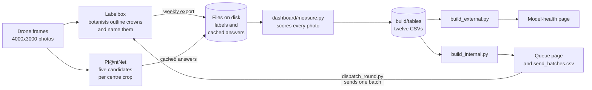
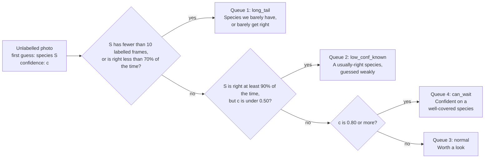
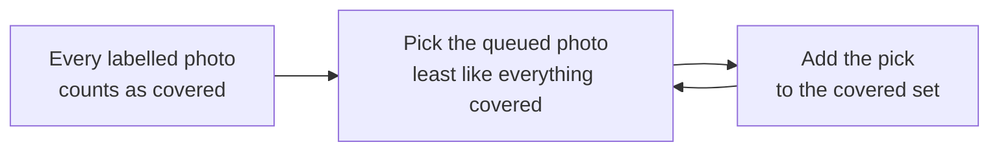
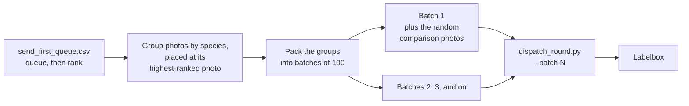
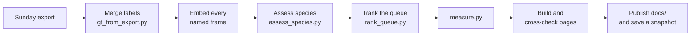
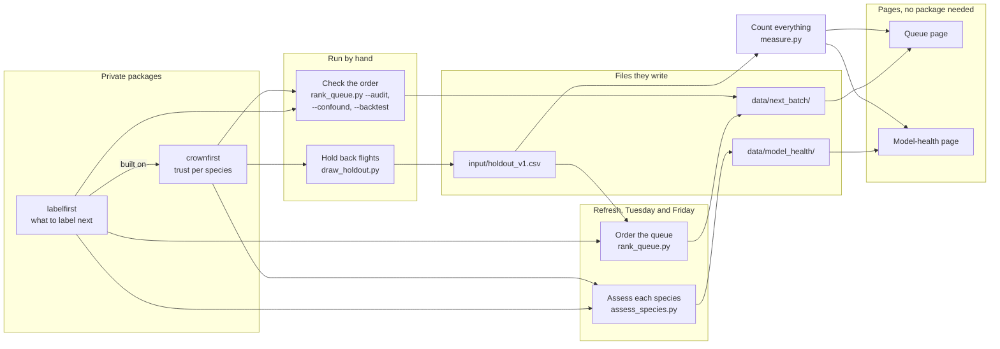

# BCI dashboard

Botanists outline tree crowns in drone photos of BCI and name each species in Labelbox. Pl@ntNet, a plant-naming service, guesses the species in the same photos. This repo turns those two sources into self-contained HTML pages that answer two questions:

1. **How well does Pl@ntNet name BCI trees?** The model-health page, for anyone outside the lab.
2. **Which photo should a botanist label next?** The queue page, for the labelling team.

## How it fits together



Both pages read one measurement pass, so they cannot disagree. The builders read only files on disk, so the same files always give the same page. Each builder recomputes every number it prints and stops if `build/tables` disagrees, batch assignment included.

## The pages

The site publishes these pages from `docs/`:

- the model-health page, by `dashboard/build_external.py`: per species, how often the first guess is right, on how many labelled frames, and why the species carries its status
- the queue page, by `dashboard/build_internal.py`
- the photo explorer, by `dashboard/build_explorer.py` from `labelling/export_explorer.py`
- the photo atlas (drone map and similar photos), by `dashboard/build_embedding_atlas.py` from `labelling/project_atlas_tsne.py`
- the crown-first atlas, by `dashboard/build_embedding_atlas.py`
- the index and about pages, by `dashboard/build_index.py`

## What to label next

The queue page orders every unlabelled photo that has a cached Pl@ntNet answer.

### A rule picks the queue



`send_first_queue.csv` lists the queues in order 1, 2, 3, 4. A photo that reaches the third test belongs to a species with 10 or more labelled frames, so a confident guess there is enough to push it down the queue. The two-part wait rule behind queue 4 is measured on frames held back for grading, and the queue page shows every confidence line it was compared against.

The numbers are `dashboard/core.py` constants and the rule is `queues.queue_of_prediction`. The page prints both from the same source.

A frame held back for grading (it carries a split in `data/splits.csv`) never enters a queue, and neither does a frame Pl@ntNet returned no answer for. The page counts both.

### Inside a queue, the least familiar photo goes first

Pl@ntNet turns each centre crop into 768 numbers that describe how the photo looks to the model. Two photos with close numbers look alike. `labelling/rank_queue.py` uses those numbers to order each queue:



A photo very like one just picked drops back. Confidence only breaks a tie. The picking is `greedy_kcenter` from labelfirst, and no label or prediction steers it.

On the frames a botanist has already named, the order covers half of their species in far fewer photos than a random order, on every seed. `labelling/rank_queue.py --backtest` is the check, and the queue page prints the current figures and draws its curve.

The ranking lands in `data/next_batch/queue_novelty.csv`. The weekly refresh writes it and `bin/refresh.sh` does not. `dashboard/build_internal.py` refuses to build when the file is missing or ranks none of the queued photos.

### Batches carry each species whole

`send_batches.csv` packs the ordered queue into batches of 100, or `BCI_BATCH_SIZE`. A species ships at the place of its highest-ranked photo, with every other photo of that species beside it. The first batch gives 15% of its places (`CONTROL_FRACTION`) to photos drawn at random from the whole pool, as a comparison for the queue.



So the queues mix in send order. A queue 4 photo ships with its species' photos from queue 2 or 3. Only a species with no photo in queues 1 to 3 waits for the last batches.

## What a number means

Three things to know before reading a number:

- **The headline is measured crown by crown.** One call goes to Pl@ntNet per labelled crown, pooled to the frame by box area, on 300 frames frozen before the numbers existed. `input/confirmatory_frames_2026-08.csv` is that list. It is the cost of naming trees already found, not of finding them.
- **Every other rate comes from a fixed 1280x1280 centre crop**, 13.7% of the frame, while a botanist draws crowns anywhere in it. The pages score every frame with no coverage condition applied. `MIN_CROP_COVERAGE` (0.50) asks a different question: does the frame's own label fill half of the *crop* the model was sent. The pages only report it, in `coverage_gate.csv`. `labelling/next_batch.py` filters on it.
- **A miss counts only inside a known population.** A species missing from a cached list of five names is unproven either way.

Box geometry comes from the labels. The fetch records the crop it sent (`ingest_photos.stamp_geometry()`), but the cached predictions carry none, so `crop_overlap.crop_rect()` reconstructs it from the frame constants.

## Build the pages

Run the measurement pass first, or use the local refresh:

```bash
python3 dashboard/measure.py --out-dir build/tables   # the measurement pass
python3 dashboard/build_external.py                   # writes build/model_health_dashboard.html
python3 dashboard/build_internal.py                   # writes build/label_queue_dashboard.html,
                                                      # plus send_first_queue.csv and send_batches.csv beside it
bin/refresh.sh                                        # local: export, measure, both pages, snapshot
bin/refresh.sh path/to/export.ndjson                  # a named export instead of the newest
```

`bin/refresh.sh` takes the newest export in `data/exports` or `~/Downloads` when given no path.

`dashboard/build_external.py` refuses to build when `data/model_health/` is missing or older than the labels. Regenerate it with `labelling/assess_species.py` in the crownfirst virtualenv, or set `CROWNFIRST_PYTHON` so `bin/refresh.sh` does it.

`bin/publish_thumbs.sh` builds the 480px thumbnail release the atlases and the explorer load.

## The weekly refresh

`.github/workflows/weekly-refresh.yml` runs `bin/refresh_snapshot.py` every Tuesday and Friday, on the newest Sunday export. It downloads the Sunday export from the Arbutus bucket (variables `ARBUTUS_S3_ENDPOINT`, `BCI_LABELBOX_EXPORTS`, `BCI_LABELBOX_PROJECTS`; secrets `ARBUTUS_S3_ACCESS_KEY`, `ARBUTUS_S3_SECRET_KEY`) and runs these steps:



A dated `snapshots/` folder records a day the labels moved. No build reads one back.

## Where things live

- `predict/` calls Pl@ntNet, caches its answers, and makes the 768 numbers per centre crop (`predict/embed.py`).
- `labelling/` talks to Labelbox: it merges exports into labels, ranks the queue, sends batches, and writes the species assessments and the atlas inputs.
- `dashboard/` holds `measure.py` and the page builders.
- `bin/` holds the local and weekly refresh and the publish scripts.
- `docs/` is the published site, with the CSVs its pages link.

Three of the twelve CSVs in `build/tables` are evidence a person opens rather than page input: `filter_gain.csv`, `name_reconciliation.csv` and `coverage_gate.csv`. `measure.NOT_READ_BACK_BY_A_BUILD` names them.

`input/boxes/` is tracked, unlike the other data folders, because the frame list in it defines the population every number is counted over. Each module's docstring says why it is shaped the way it is.

## Research libraries

Two private Python packages do the research work behind the queue page and the model-health page:

- **labelfirst** works on any items a model turns into numbers. It puts the unlabelled photos in order, least like everything already labelled first. It then tests that order against a random order.
- **crownfirst** is built on labelfirst and knows about crowns, flights and sites. It grades Pl@ntNet for each species, and it keeps that grading fair.

In short, labelfirst says which photo a botanist names next. crownfirst says how far to trust Pl@ntNet for each species.

Only the scripts in `labelling/` and `predict/` import them. Those scripts write files, and `dashboard/` only reads those files. So the pages build without either package.

### Which script uses which package



The refresh runs `assess_species.py` and `rank_queue.py` every Tuesday and Friday (see [The weekly refresh](#the-weekly-refresh)). A person runs the other checks when the labels or the inventory change a lot.

| What you see | Package | When | File |
|---|---|---|---|
| **Queue page** | | | |
| Order inside each queue | labelfirst | Refresh | `data/next_batch/queue_novelty.csv` |
| Against a random order | labelfirst | By hand | `data/next_batch/selection_audit.json` |
| The site or the export batch held fixed | crownfirst | By hand | `data/next_batch/selection_confound.json` |
| Species found per photo | crownfirst | By hand | `data/next_batch/discovery_curve.csv` |
| **Model-health page** | | | |
| What would help | crownfirst | Refresh | `data/model_health/transductive.json` |
| Why the two names differ | crownfirst | Refresh | `data/model_health/disagreement.json` |
| Plausible names | crownfirst | Refresh | `data/model_health/reject_sweep.json` |
| Species the labels have reached | labelfirst | Refresh | `data/model_health/` |
| Grades on flights held back whole | crownfirst | By hand | `input/holdout_v1.csv` |

### How each check works

Every check starts from how a photo looks: the 768 numbers Pl@ntNet makes from a centre crop. Close numbers mean two photos look alike to the model.

#### On the queue page

**Which photo goes next?** See [Inside a queue, the least familiar photo goes first](#inside-a-queue-the-least-familiar-photo-goes-first). The picking is labelfirst's `greedy_kcenter`.

**Does the order beat a random order?** `rank_queue.py --audit` replays labelling on the labelled frames. Each replay starts from 200 random labelled frames and adds 20 rounds of 20 photos. It counts the rare species found, meaning those with 5 labelled frames or fewer.

The order and a random order each run from 8 random starts. labelfirst compares the two curves and gives a range and a p-value. First, `predict_al_benefit` asks if any order can help: how often does a labelled frame's nearest neighbour have the same species?

**Is it finding plants, or places?** A photo can look new because it comes from a new site or export batch, not a new species. `rank_queue.py --confound` holds the site or the export batch fixed. It then asks if "looks new" still goes with "rare species".

It shuffles the frames inside each group 5,000 times to see how often chance does as well. The page says the link holds, is partly the batch, or is mostly the batch.

**Species found per photo.** `rank_queue.py --backtest` puts the labelled frames in order without reading their labels. It compares the species found against 16 random orders, and the queue page draws the curve.

#### On the model-health page

`assess_species.py` writes four assessments into `data/model_health/`. The page does not build when one is missing or stale, and it names the command that fixes it.

**What would help each species?** Hide the labels on half of the labelled frames. The 5 closest labelled frames vote on the name of each hidden frame. Do this 8 times, with a different half each time. Then, per species:

- Right 90% of the time or more: "no gap found".
- Less than 10% of its frames kept a label: "more labels".
- Else: "better model".

The page shows how many of the 8 draws agree, and stays blank under 10 frames.

**Why do the two names differ?** crownfirst lists the frames where Pl@ntNet's first guess is not the label. It sorts each one as two different species, one species under two names, or a label that stops at genus or family.

**How many plausible names?** A plain classifier learns from how the photos look, in 5 folds. For each frame it lists the names it cannot rule out, built to hold the right name 90% of the time.

For lists of 1, 2, 3, 5 and 10 names, it reports how many frames get one and how often the first name is right. A second run keeps each flight whole in one fold. This classifier is not Pl@ntNet.

**How many species are still unlabelled?** labelfirst's `estimate_richness` counts the species seen once and seen twice. From those counts it estimates how many species no label names yet (Chao1).

#### Behind every grade

**Flights held back whole.** Frames from one flight are near-copies of each other. `draw_holdout.py` holds back 1 flight in 5, and every species with two or more flights keeps one for training.

Training frames from another flight within 30 m of a held frame are dropped too. The queue never sends a held frame, and the model-health page grades Pl@ntNet again on them.

### Other uses

- `labelling/rank_arms.py` tests two more orders against a random order, with labelfirst's ordering rules.
- `labelling/measure_similarity_range.py` measures how far apart two photos must be before they stop looking alike.
- `predict/ingest_photos.py` and `predict/aggregate_survey.py` use labelfirst to pool the results per tile into one vector and one species score per photo.
- When `data/crownfirst/plantclef2024_tile2x2_max.json` exists, the refresh adds a second view to the atlas page. It shows how the photos look to a crownfirst test model.

### Install

Both are private `traitlab` repos, not on PyPI, and crownfirst needs Python 3.13. `rank_queue.py` imports both, so even the plain ordering needs crownfirst. Install crownfirst into its own virtualenv and labelfirst comes with it, pinned to the commit crownfirst names:

```bash
pip install "crownfirst @ git+https://github.com/traitlab/crownfirst.git"
```

## Configure

Copy `.env.example`. `.env` is gitignored and is the only place a key belongs: `PLANTNET_API_KEY` for `predict/`, plus `LABELBOX_API_KEY` for `labelling/`.

The Labelbox workspace IDs are not secret, so they sit in `config.yaml`. `LABELBOX_DATASET_ID`, `LABELBOX_PROJECT_ID` and the `BCI_DASHBOARD_*` path variables override them.

## Test

```bash
uv pip install -r requirements-dev.txt          # once, into .venv
.venv/bin/pytest
```

Name the interpreter. Tests covering `predict/` skip themselves when `PIL`, `yaml` or `dotenv` is missing, so a system interpreter runs two thirds of the suite and still reports a pass. The tests for `rank_queue.py`, `rank_confound.py` and `draw_holdout.py` skip the same way without crownfirst and labelfirst; CI runs them in the `private-libs` job. `-ra` is on, so every skip prints why.
