# BCI dashboard

Botanists outline tree crowns in drone photos of BCI and name each species in Labelbox. Pl@ntNet, a plant-naming service, guesses the species in the same photos. This repo turns the two into HTML pages that answer two questions:

1. **How well does Pl@ntNet name BCI trees?** The model-health page, for anyone outside the lab.
2. **Which photo should a botanist label next?** The queue page, for the labelling team.

## How it fits together

<picture>
  <source media="(prefers-color-scheme: dark)" srcset="diagrams/pipeline-dark.svg">
  
</picture>

One measurement pass feeds both pages, so they cannot disagree. The builders read only files on disk. Each builder recomputes every number it prints and stops if `build/tables` disagrees, batch assignment included.

## The pages

The site publishes these pages from `docs/`:

- the model-health page, by `dashboard/build_external.py`: per species, how often the top prediction is right, on how many labelled frames, and why the species carries its status
- the queue page, by `dashboard/build_internal.py`
- the photo explorer, by `dashboard/build_explorer.py`
- the photo atlas (drone map and similar photos) and the crown-first atlas, by `dashboard/build_embedding_atlas.py`
- the index and about pages, by `dashboard/build_index.py`

## What to label next

The queue page orders every unlabelled photo that has a cached Pl@ntNet answer.

### A rule picks the queue

<picture>
  <source media="(prefers-color-scheme: dark)" srcset="diagrams/queue-rule-dark.svg">
  
</picture>

`send_first_queue.csv` lists the queues in order 1, 2, 3, 4. A photo that reaches the third test belongs to a species with 10 or more labelled frames. A confident guess there is enough to push it down the queue. The wait rule behind queue 4 is measured on frames held back for grading. The queue page shows every confidence line it was compared against.

The numbers are `dashboard/core.py` constants and the rule is `queues.queue_of_prediction`. The page prints both from the same source.

A frame held back for grading (it carries a split in `data/splits.csv`) never enters a queue. Neither does a frame Pl@ntNet returned no answer for. The page counts both.

### Inside a queue, the least familiar photo goes first

Pl@ntNet turns each centre crop into 768 numbers that describe how the photo looks to the model. Two photos with close numbers look alike. `labelling/rank_queue.py` uses those numbers to order each queue:

<picture>
  <source media="(prefers-color-scheme: dark)" srcset="diagrams/queue-order-dark.svg">
  
</picture>

A photo very like one just picked drops back. Confidence only breaks a tie. The picking is `greedy_kcenter` from labelfirst, and no label or guess steers it.

On the labelled frames, this order covers half of their species in far fewer photos than a random order, on every seed. `labelling/rank_queue.py --backtest` is the check. The queue page prints the current figures and draws the curve.

The ranking lands in `data/next_batch/queue_novelty.csv`. The weekly refresh writes it and `bin/refresh.sh` does not. `dashboard/build_internal.py` refuses to build when the file is missing or ranks none of the queued photos.

### Batches: predicted trees, in random order

`labelling/catalog_batches.py` packs the catalog pool (the dataset rows in no project) into batches of 100 and writes `send_batches.csv`. Antoine sends one batch at a time with `bin/send_batch.py`. The rules, in order:

1. **Only photos Pl@ntNet calls a tree.** A photo is liana when liana species hold half or more of its top-5 score (`LIANA_SHARE`). Liana photos and `can_wait` photos stay in `send_first_queue.csv` with a blank `batch_id`. A `can_wait` photo is a species with 10 or more labelled crowns that the model already names with confidence. The botanists label trees: Antoine's decision.
2. **Priority missions first.** Every photo of a mission in `input/priority_missions.txt` (ground data on its crowns) fills the first batches, whatever its queue.
3. **Then the queues in order,** rarest species first inside a queue, at most 20 photos of one species per batch (`SPECIES_CAP`).
4. **15 control photos per batch** (`CONTROL_FRACTION`), drawn at random from the pool before packing, seeded (`CONTROL_SEED`). See [The random control](#the-random-control).
5. **Random order inside the batch,** seeded per batch. The botanist cannot read the guess off the grouping. Labelbox never gets the guess: the sender pushes the data row and the batch name only.

<picture>
  <source media="(prefers-color-scheme: dark)" srcset="diagrams/batches-dark.svg">
  
</picture>

Batches 1 to 4 are pinned in `input/pinned_batches.csv`. The weekly refresh keeps four unsent batches pinned ahead (`KEEP_AHEAD`), so a label change never moves a photo Antoine is about to send. The page build refuses a `send_batches.csv` that is not the exact packing, order included.

A Labelbox batch is named `batchXXXX_YYYY-MM`, a counter and the month it is sent, and every data row in it carries that name as `batch_id` metadata. Build the file with `python labelling/catalog_batches.py --pool data/predictions_catalog_2026/input.csv --cache data/predictions_catalog_2026/cache --out build/catalog_batches`. Without a catalog pool, `dashboard/measure.py` packs the main pool instead, each species whole, 20 places per batch for queue 2 (`BCI_QUEUE2_SHARE`).

### The random control

The 15 control photos in every batch are a random sample of the pool. Their labels give the pool's top-1 accuracy with no bias from the queue. They are marked `picked_by == control` in `send_batches.csv`, mixed into the batch like any other photo, and never sent twice. The draw is seeded, so every run writes the same file. `CONTROL_FRACTION = 0` turns it off.

`labelling/read_round.py --sent docs/send_batches.csv --cache data/predictions_catalog_2026/cache` prints the pool accuracy two ways. First the plain control share with its range. Then PPI++ (Angelopoulos, Duchi and Zrnic 2023), which adds the model's confidence over every pool photo and narrows the range by about a fifth. The control labels are the only truth. Under 60 control photos (four batches), read only the plain range. Round 1 reads the number to about plus or minus 9 points. `input/rounds/preregistration.md` fixed the estimand, the label rule and "no pass mark" before any label arrived.

Why a control in every batch: later pools are reshaped by the queue, so the comparison cannot be drawn afterwards. It is also the only fair test of whether the queue order fills gaps faster than random, which `read_round.py` reports per round on the queue page. The cost is 15% of the labelling time on photos the queue would not have picked first.

## What a number means

Three things to know before reading a number:

- **The headline is measured crown by crown.** One call goes to Pl@ntNet per labelled crown, pooled to the frame by box area, on 300 frames frozen before the numbers existed. `input/confirmatory_frames_2026-08.csv` is that list. It is the cost of naming trees already found, not of finding them.
- **Every other rate comes from a fixed 1280x1280 centre crop**, 13.7% of the frame, while a botanist draws crowns anywhere in it. The pages score every frame with no coverage condition applied. `MIN_CROP_COVERAGE` (0.50) asks a different question: does the frame's own label fill half of the *crop* the model was sent. The pages only report it, in `coverage_gate.csv`. `labelling/next_batch.py` filters on it.
- **A miss counts only inside a known population.** A species missing from a cached list of five names is unproven either way.

Box geometry comes from the labels. The fetch records the crop it sent (`ingest_photos.stamp_geometry()`). The cached guesses carry none, so `crop_overlap.crop_rect()` rebuilds it from the frame constants.

## Build the pages

Run the measurement pass first, or use the local refresh:

```bash
python3 dashboard/measure.py --out-dir build/tables   # the measurement pass
python3 dashboard/build_external.py                   # writes build/model_health_dashboard.html
python3 dashboard/build_internal.py                   # writes build/label_queue_dashboard.html,
                                                      # plus send_first_queue.csv and send_batches.csv beside it
bin/refresh.sh                                        # local: export, measure, both pages, snapshot
bin/refresh.sh path/to/export.ndjson                  # a named export instead of the newest
```

`bin/refresh.sh` takes the newest export in `data/exports` or `~/Downloads` when given no path.

`dashboard/build_external.py` refuses to build when `data/model_health/` is missing or older than the labels. Regenerate it with `labelling/assess_species.py` in the crownfirst virtualenv, or set `CROWNFIRST_PYTHON` so `bin/refresh.sh` does it.

`bin/publish_thumbs.sh` builds the 480px thumbnail release the atlases and the explorer load.

## The weekly refresh

`.github/workflows/weekly-refresh.yml` runs `bin/refresh_snapshot.py` every Tuesday and Friday, on the newest Sunday export. It downloads the export from the Arbutus bucket (variables `ARBUTUS_S3_ENDPOINT`, `BCI_LABELBOX_EXPORTS`, `BCI_LABELBOX_PROJECTS`; secrets `ARBUTUS_S3_ACCESS_KEY`, `ARBUTUS_S3_SECRET_KEY`) and runs these steps:

<picture>
  <source media="(prefers-color-scheme: dark)" srcset="diagrams/weekly-refresh-dark.svg">
  
</picture>

A dated `snapshots/` folder records a day the labels moved. No build reads one back.

## Where things live

- `predict/` calls Pl@ntNet, caches its answers, and makes the 768 numbers per centre crop (`predict/embed.py`).
- `labelling/` talks to Labelbox: it merges exports into labels, ranks the queue, sends batches, and writes the species assessments and the atlas inputs.
- `dashboard/` holds `measure.py` and the page builders.
- `bin/` holds the local and weekly refresh and the publish scripts.
- `docs/` is the published site, with the CSVs its pages link.
- `diagrams/` holds the README flowcharts as mermaid source. `bin/render_diagrams.sh` redraws their SVGs.

Three CSVs in `build/tables` are evidence a person opens rather than page input: `filter_gain.csv`, `name_reconciliation.csv` and `coverage_gate.csv`. `measure.NOT_READ_BACK_BY_A_BUILD` names them.

`input/boxes/` is tracked, unlike the other data folders, because the frame list in it defines the population every number is counted over.

## Research libraries

Two private Python packages do the research work behind the two pages:

- **labelfirst** works on any items a model turns into numbers. It puts the unlabelled photos in order, least like everything already labelled first, and tests that order against a random order.
- **crownfirst** is built on labelfirst and knows about crowns, flights and sites. It grades Pl@ntNet for each species, and keeps that grading fair.

Only the scripts in `labelling/` and `predict/` import them. Those scripts write files, and `dashboard/` only reads those files. So the pages build without either package.

### Which script uses which package

<picture>
  <source media="(prefers-color-scheme: dark)" srcset="diagrams/packages-dark.svg">
  
</picture>

The refresh runs `assess_species.py` and `rank_queue.py`. A person runs the other checks when the labels or the inventory change a lot. [`RESEARCH.md`](RESEARCH.md) says what each check does.

| What you see | Package | When | File |
|---|---|---|---|
| **Queue page** | | | |
| Order inside each queue | labelfirst | Refresh | `data/next_batch/queue_novelty.csv` |
| Against a random order | labelfirst | By hand | `data/next_batch/selection_audit.json` |
| The site or the export batch held fixed | crownfirst | By hand | `data/next_batch/selection_confound.json` |
| Species found per photo | crownfirst | By hand | `data/next_batch/discovery_curve.csv` |
| **Model-health page** | | | |
| What would help | crownfirst | Refresh | `data/model_health/transductive.json` |
| Why the two names differ | crownfirst | Refresh | `data/model_health/disagreement.json` |
| Plausible names | crownfirst | Refresh | `data/model_health/reject_sweep.json` |
| Species the labels have reached | labelfirst | Refresh | `data/model_health/` |
| Grades on flights held back whole | crownfirst | By hand | `input/holdout_v1.csv` |

### Install

Both are private `traitlab` repos, not on PyPI, and crownfirst needs Python 3.13. `rank_queue.py` imports both, so even the plain ordering needs crownfirst. Install crownfirst into its own virtualenv and labelfirst comes with it, pinned to the commit crownfirst names:

```bash
pip install "crownfirst @ git+https://github.com/traitlab/crownfirst.git"
```

## Configure

Copy `.env.example`. `.env` is gitignored and is the only place a key belongs: `PLANTNET_API_KEY` for `predict/`, plus `LABELBOX_API_KEY` for `labelling/`.

The Labelbox workspace IDs are not secret, so they sit in `config.yaml`. `LABELBOX_DATASET_ID`, `LABELBOX_PROJECT_ID` and the `BCI_DASHBOARD_*` path variables override them.

## Test

```bash
uv pip install -r requirements-dev.txt          # once, into .venv
.venv/bin/pytest
```

Name the interpreter: tests that need `PIL`, `yaml`, `dotenv`, crownfirst or labelfirst skip themselves when the package is missing, and `-ra` prints every skip. CI runs the crownfirst and labelfirst tests in the `private-libs` job.
